<div align="center">

# 👁️ Computer Vision Mastery with OpenCV

> **A comprehensive, hands-on roadmap to mastering Computer Vision using Python and OpenCV — from raw pixel manipulation to Deep Neural Networks.**

[](https://python.org)
[](https://opencv.org)
[](https://numpy.org)
[](https://jupyter.org)
[](https://github.com)

<p align="center">
  <a href="#-curriculum-overview">Curriculum Overview</a> •
  <a href="#-module-directory--quick-links">Module Directory</a> •
  <a href="#-interactive-learning-roadmap">Roadmap</a> •
  <a href="#-quick-start--setup">Quick Start</a> •
  <a href="#-real-world-projects">Real-World Projects</a>
</p>

</div>

---

## 🌟 Highlights of This Learning Path

- 📚 **20 Core Hands-on Modules**: Every module contains in-depth theory (`readme.md`), interactive Jupyter notebooks, sample code, and test datasets.
- 🔬 **From Pixels to Deep Learning**: Start with pixel coordinates and color representations, advance through spatial convolution, feature matching, and culminate in deep neural network inference (YOLO, SSD, MobileNet).
- 🧪 **Interactive Labs**: Pre-configured Jupyter Notebooks allowing instant experimentation with image filters, thresholding, edge detectors, and contours.
- 🎯 **Practical Engineering Focus**: Learn how to build real-world computer vision systems such as document scanners, motion-detecting surveillance cams, face detectors, and object trackers.

---

## 🗺️ Learning Path Architecture

```mermaid
flowchart TD
    subgraph P1["Phase 1: Foundations & Image Manipulation"]
        M1["Module 01: CV Intro & I/O"] --> M2["Module 02: Image Basics & Pixels"]
        M2 --> M3["Module 03: Transformations & Crop"]
        M3 --> M4["Module 04: Drawing Shapes & Text"]
        M4 --> M5["Module 05: Color Spaces (HSV, LAB)"]
        M5 --> M6["Module 06: Arithmetic & Blending"]
    end

    subgraph P2["Phase 2: Filtering, Edges & Contours"]
        M6 --> M7["Module 07: Spatial Filtering & Blurring"]
        M7 --> M8["Module 08: Thresholding (Adaptive/Otsu)"]
        M8 --> M9["Module 09: Morphological Operations"]
        M9 --> M10["Module 10: Edge Detection (Canny)"]
        M10 --> M11["Module 11: Contours & Shapes"]
    end

    subgraph P3["Phase 3: Geometry, Features & Detection"]
        M11 --> M12["Module 12: Histograms & CLAHE"]
        M12 --> M13["Module 13: Affine & Perspective Warp"]
        M13 --> M14["Module 14: Feature Detectors (ORB/SIFT)"]
        M14 --> M15["Module 15: Image & Template Matching"]
        M15 --> M16["Module 16: Haar Cascades (Face/Eye)"]
    end

    subgraph P4["Phase 4: Video, Tracking & Deep Learning"]
        M16 --> M17["Module 17: Video Streams & Webcams"]
        M17 --> M18["Module 18: Motion Detection (MOG2)"]
        M18 --> M19["Module 19: Object Tracking (CSRT/KCF)"]
        M19 --> M20["Module 20: OpenCV Deep Learning (DNN/YOLO)"]
    end

    subgraph P5["Phase 5: Beyond & Capstone Projects"]
        M20 --> M21["Modules 21-25: OCR, Face Recog, Segmentation & AI"]
    end

    style P1 fill:#1e293b,stroke:#38bdf8,stroke-width:2px,color:#f8fafc
    style P2 fill:#1e293b,stroke:#818cf8,stroke-width:2px,color:#f8fafc
    style P3 fill:#1e293b,stroke:#a855f7,stroke-width:2px,color:#f8fafc
    style P4 fill:#1e293b,stroke:#ec4899,stroke-width:2px,color:#f8fafc
    style P5 fill:#1e293b,stroke:#22c55e,stroke-width:2px,color:#f8fafc
```



---

## 📂 Module Directory & Quick Links

| # | Module | Core Topics | Interactive Lab | Level |
|---|---|---|:---:|:---:|
| **01** | [Introduction to Computer Vision](./Module%2001%20-%20Introduction%20to%20Computer%20Vision/readme.md) | CV Pipeline, Image I/O (`imread`, `imshow`, `imwrite`), Formats | [Intro.ipynb](./Module%2001%20-%20Introduction%20to%20Computer%20Vision/Intro.ipynb) | `Beginner` |
| **02** | [Image Basics](./Module%2002%20-%20Image%20Basics/readme.md) | Pixels, Resolution, Channels, RGB vs BGR, Grayscale, Alpha | [Example.ipynb](./Module%2002%20-%20Image%20Basics/Example.ipynb) | `Beginner` |
| **03** | [Image Manipulation](./Module%2003%20-%20Image%20Manipulation/readme.md) | Resizing, Cropping, Rotating, Flipping, Translation, Aspect Ratio | [Example.ipynb](./Module%2003%20-%20Image%20Manipulation/Example.ipynb) | `Beginner` |
| **04** | [Drawing on Images](./Module%2004%20-%20Drawing%20on%20Images/readme.md) | Geometric Primitives (Lines, Circles, Rectangles), Custom Text | [Example.ipynb](./Module%2004%20-%20Drawing%20on%20Images/Example.ipynb) | `Beginner` |
| **05** | [Color Spaces](./Module%2005%20-%20Color%20Spaces/readme.md) | BGR, RGB, HSV, LAB, YCrCb conversions & Color Masking | [Example.ipynb](./Module%2005%20-%20Color%20Spaces/Example.ipynb) | `Beginner` |
| **06** | [Image Arithmetic](./Module%2006%20-%20Image%20Arithmetic/readme.md) | Pixel Addition, Subtraction, Bitwise Operations, Alpha Blending | [Example.ipynb](./Module%2006%20-%20Image%20Arithmetic/Example.ipynb) | `Beginner` |
| **07** | [Image Filtering](./Module%2007%20-%20Image%20Filtering/readme.md) | Box Blur, Gaussian Blur, Median Filtering, Bilateral Filtering | [Example.ipynb](./Module%2007%20-%20Image%20Filtering/Example.ipynb) | `Intermediate` |
| **08** | [Thresholding](./Module%2008%20-%20Thresholding/readme.md) | Binary, Inverse, Adaptive Thresholding, Otsu's Bimodal Method | [Example.ipynb](./Module%2008%20-%20Thresholding/Example.ipynb) | `Intermediate` |
| **09** | [Morphological Operations](./Module%2009%20-%20Morphological%20Operations/readme.md) | Erosion, Dilation, Opening, Closing, Morphological Gradient, Top/Black Hat | [Example.ipynb](./Module%2009%20-%20Morphological%20Operations/Example.ipynb) | `Intermediate` |
| **10** | [Edge Detection](./Module%2010%20-%20Edge%20Detection/readme.md) | Sobel Operators, Scharr, Laplacian, Multi-Stage Canny Detection | [Example.ipynb](./Module%2010%20-%20Edge%20Detection/Example.ipynb) | `Intermediate` |
| **11** | [Contours](./Module%2011%20-%20Contours/readme.md) | Contour Extraction, Hierarchies, Area, Perimeter, Convex Hull, Moments | [Example.ipynb](./Module%2011%20-%20Contours/Example.ipynb) | `Intermediate` |
| **12** | [Histograms](./Module%2012%20-%20Histograms/readme.md) | 1D & 2D Histograms, Histogram Equalization, CLAHE, Comparison | [Example.ipynb](./Module%2012%20-%20Histograms/Example.ipynb) | `Intermediate` |
| **13** | [Geometric Transformations](./Module%2013%20-%20Geometric%20Transformations/readme.md) | Affine Warping, 4-Point Perspective Transform, Homography | [Example.ipynb](./Module%2013%20-%20Geometric%20Transformations/Example.ipynb) | `Intermediate` |
| **14** | [Feature Detection](./Module%2014%20-%20Feature%20Detection/readme.md) | Harris Corners, Shi-Tomasi, FAST, ORB, SIFT, Descriptor Vectors | [Example.ipynb](./Module%2014%20-%20Feature%20Detection/Example.ipynb) | `Advanced` |
| **15** | [Image Matching](./Module%2015%20%E2%80%93%20Image%20Matching/readme.md) | Template Matching, Brute-Force Matcher (BFMatcher), FLANN | [Exanple.ipynb](./Module%2015%20%E2%80%93%20Image%20Matching/Exanple.ipynb) | `Advanced` |
| **16** | [Object Detection Basics](./Module%2016%20-%20Object%20Detection%20Basics/readme.md) | Haar Cascades, Integral Images, AdaBoost, Face & Smile Detectors | [Example.ipynb](./Module%2016%20-%20Object%20Detection%20Basics/Example.ipynb) | `Advanced` |
| **17** | [Video Processing](./Module%2017%20-%20Video%20Processing%20using%20OpenCV/readme.md) | `VideoCapture`, `VideoWriter`, FPS Calculation, Real-time Webcams | Theory & Code | `Advanced` |
| **18** | [Motion Detection](./Module%2018%20-%20Motion%20Detection/readme.md) | Frame Differencing, Background Subtraction (MOG2, KNN), Optical Flow | Theory & Code | `Advanced` |
| **19** | [Object Tracking](./Module%2019%20-%20Object%20Tracking/readme.md) | OpenCV Trackers: CSRT, KCF, MOSSE, MedianFlow Benchmarking | Theory & Code | `Advanced` |
| **20** | [Deep Learning with OpenCV](./Module%2020%20-%20Deep%20Learning%20with%20OpenCV/readme.md) | OpenCV DNN Module, Loading Pre-trained YOLO, SSD, MobileNet | Theory & Code | `Advanced` |

### 🧪 Bonus Practical Experiments
- [Digital Image Processing Experiments](./Digital%20Image%20Processing): 12 complete university-grade practical labs covering Point Transformations, Spatial Domain Filtering, Hough Transforms, and Image Segmentation.
- [Image Enhancement Techniques](./Image%20Enhancement%20Techniques%20using%20OpenCV): Focused exploration of image enhancement pipelines.

---

## 📚 Curriculum Breakdown by Phase

<details>
<summary><b>🟢 Phase 1: Foundations & Image Manipulation (Modules 01 - 06)</b></summary>

### [Module 01: Introduction to Computer Vision](./Module%2001%20-%20Introduction%20to%20Computer%20Vision/readme.md)
- **Topics**: What is CV?, Biological vs Machine Vision, OpenCV Pipeline, `cv2.imread`, `cv2.imshow`, `cv2.imwrite`, Image Formats.
- **Hands-on**: Load, inspect, convert, and save multi-format image datasets.

### [Module 02: Image Basics](./Module%2002%20-%20Image%20Basics/readme.md)
- **Topics**: Pixels as NumPy ndarrays, coordinate grids $(x, y)$, resolution, BGR vs RGB channel order, grayscale intensity, alpha transparency.
- **Hands-on**: Accessing pixel values, modifying sub-regions, inspecting shape, channels, and data types.

### [Module 03: Image Manipulation](./Module%2003%20-%20Image%20Manipulation/readme.md)
- **Topics**: Interpolation methods (`INTER_LINEAR`, `INTER_CUBIC`), cropping with slicing, affine rotation matrices, flipping, scaling with preserved aspect ratio.
- **Hands-on**: Passport photo trimmer, thumbnail generator, custom image rotator.

### [Module 04: Drawing on Images](./Module%2004%20-%20Drawing%20on%20Images/readme.md)
- **Topics**: Vector annotations with `cv2.line`, `cv2.rectangle`, `cv2.circle`, `cv2.ellipse`, `cv2.polylines`, and typography with `cv2.putText`.
- **Hands-on**: Bounding box visualizer, telemetry HUD overlay, coordinate grid renderer.

### [Module 05: Color Spaces](./Module%2005%20-%20Color%20Spaces/readme.md)
- **Topics**: BGR, RGB, HSV (Hue-Saturation-Value), LAB, YCrCb, and Grayscale; selecting the optimal color space for segmentation.
- **Hands-on**: Real-world color detection, green-screen chroma keying, HSV threshold sliders.

### [Module 06: Image Arithmetic](./Module%2006%20-%20Image%20Arithmetic/readme.md)
- **Topics**: Saturated arithmetic vs modulo arithmetic, `cv2.add`, `cv2.subtract`, Bitwise operations (`AND`, `OR`, `XOR`, `NOT`), alpha blending (`cv2.addWeighted`).
- **Hands-on**: Watermarking images, dynamic logo overlay with transparency masks.

</details>

<details>
<summary><b>🔵 Phase 2: Filtering, Edges & Contours (Modules 07 - 11)</b></summary>

### [Module 07: Image Filtering](./Module%2007%20-%20Image%20Filtering/readme.md)
- **Topics**: Convolution matrices, Box Filter, Gaussian Blur, Median Blur (salt-and-pepper noise removal), Bilateral Filter (edge-preserving smoothing), Sharpening kernels.
- **Hands-on**: De-noising camera captures, portrait skin smoothing, blur comparisons.

### [Module 08: Thresholding](./Module%2008%20-%20Thresholding/readme.md)
- **Topics**: Global thresholding, Inverse thresholding, Adaptive Mean & Gaussian Thresholding, Otsu's optimal bimodal thresholding.
- **Hands-on**: Document scanning preprocessing, extracting dark text under varying shadow conditions.

### [Module 09: Morphological Operations](./Module%2009%20-%20Morphological%20Operations/readme.md)
- **Topics**: Structuring elements (`cv2.getStructuringElement`), Erosion, Dilation, Opening (noise removal), Closing (hole filling), Gradient, Top Hat, Black Hat.
- **Hands-on**: Fingerprint gap closing, clean text separation, micro-particle counting.

### [Module 10: Edge Detection](./Module%2010%20-%20Edge%20Detection/readme.md)
- **Topics**: Image gradients, Sobel $X$ and $Y$ operators, Scharr filter, Laplacian of Gaussian, Canny Edge Detection (Gaussian blur, gradient magnitude, Non-Maximum Suppression, Hysteresis).
- **Hands-on**: Edge-based pencil sketch effect, object boundary delineation.

### [Module 11: Contours](./Module%2011%20-%20Contours/readme.md)
- **Topics**: Contour finding algorithms, hierarchy tree (`RETR_TREE`, `RETR_EXTERNAL`), contour area, perimeter, moments, centroid computation, bounding box, minimum enclosing circle, Convex Hull.
- **Hands-on**: Automatic coin counter, geometric shape classifier.

</details>

<details>
<summary><b>🟣 Phase 3: Geometry, Features & Classic Detection (Modules 12 - 16)</b></summary>

### [Module 12: Histograms](./Module%2012%20-%20Histograms/readme.md)
- **Topics**: Calculating intensity histograms (`cv2.calcHist`), CDF curves, Global Histogram Equalization, CLAHE (Contrast Limited Adaptive Histogram Equalization), Histogram comparison metrics.
- **Hands-on**: Low-contrast x-ray enhancement, image similarity scoring based on color distribution.

### [Module 13: Geometric Transformations](./Module%2013%20-%20Geometric%20Transformations/readme.md)
- **Topics**: Affine transformations (3-point mapping), Perspective transformations (4-point projective mapping), Homography computation (`cv2.findHomography`, `cv2.warpPerspective`).
- **Hands-on**: CamScanner-style mobile document deskewing, aerial bird's-eye perspective rectification.

### [Module 14: Feature Detection](./Module%2014%20-%20Feature%20Detection/readme.md)
- **Topics**: Corner & interest point detection: Harris Corner, Shi-Tomasi (`goodFeaturesToTrack`), FAST keypoints, ORB (Oriented FAST and Rotated BRIEF), SIFT, SURF, BRISK.
- **Hands-on**: Keypoint visualization, scale- and rotation-invariant feature extraction.

### [Module 15: Image Matching](./Module%2015%20%E2%80%93%20Image%20Matching/readme.md)
- **Topics**: Template Matching (`cv2.matchTemplate`), Normalized Correlation, Multi-scale template matching, Feature Matchers: BFMatcher (Brute-Force), FLANN (Fast Library for Approximate Nearest Neighbors), Lowe's ratio test.
- **Hands-on**: Brand logo locator, matching rotated and scaled objects in cluttered scenes.

### [Module 16: Object Detection Basics](./Module%2016%20-%20Object%20Detection%20Basics/readme.md)
- **Topics**: Viola-Jones object detection framework, Haar-like features, Integral Images, AdaBoost weak-classifier cascading, pre-trained XML classifiers for faces, eyes, and smiles.
- **Hands-on**: Real-time multi-face detector, smile detector, attendee counter.

</details>

<details>
<summary><b>🔴 Phase 4: Video, Tracking & Deep Learning (Modules 17 - 20)</b></summary>

### [Module 17: Video Processing using OpenCV](./Module%2017%20-%20Video%20Processing%20using%20OpenCV/readme.md)
- **Topics**: Video frame streaming (`cv2.VideoCapture`), capturing webcam feeds, encoding and saving video (`cv2.VideoWriter`, FourCC codecs), FPS metrics and latency benchmarks.
- **Hands-on**: High-speed webcam recorder, interactive video player with pause/forward controls.

### [Module 18: Motion Detection](./Module%2018%20-%20Motion%20Detection/readme.md)
- **Topics**: Frame Differencing, Background Subtraction models (`createBackgroundSubtractorMOG2`, `createBackgroundSubtractorKNN`), shadow detection, dense vs sparse Optical Flow (Lucas-Kanade).
- **Hands-on**: Home security motion alarm, burglar detection pipeline with bounding boxes.

### [Module 19: Object Tracking](./Module%2019%20-%20Object%20Tracking/readme.md)
- **Topics**: Object detection vs continuous tracking, Single-object trackers: CSRT (accurate), KCF (fast), MOSSE (ultra-high FPS), MedianFlow.
- **Hands-on**: Continuous sports ball tracker, drone vehicle trajectory follower.

### [Module 20: Deep Learning with OpenCV](./Module%2020%20-%20Deep%20Learning%20with%20OpenCV/readme.md)
- **Topics**: OpenCV DNN module (`cv2.dnn.readNet`), input blob creation (`blobFromImage`), pre-trained model inference: YOLOv3/v4/v8, SSD-MobileNet, TensorFlow/Caffe models, Non-Maximum Suppression (NMS).
- **Hands-on**: 80-class real-time COCO object detection, pedestrians and vehicle counting.

</details>

<details>
<summary><b>🚀 Phase 5: Future Horizons (Modules 21 - 25)</b></summary>

- **Module 21: Face Recognition**: Deep face embeddings, face verification, and automatic attendance systems.
- **Module 22: OCR (Optical Character Recognition)**: Tesseract OCR integration, text box localization, invoice and ID data extraction.
- **Module 23: Image Segmentation**: Watershed algorithm, GrabCut foreground extraction, semantic & instance masks.
- **Module 24: 3D Vision Basics**: Stereo vision disparity maps, depth estimation, camera matrix calibration.
- **Module 25: AI-Based Computer Vision**: Custom CNN architectures, PyTorch/TensorFlow transfer learning, and Ultralytics YOLO training.

</details>

---

## ⚡ Quick Start & Setup

### 1. Clone the Repository
```bash
git clone https://github.com/swapnil3104/Computer-Vision-Learning-Path-using-OpenCV.git
cd Computer-Vision-Learning-Path-using-OpenCV
```

### 2. Create a Virtual Environment (Recommended)
```bash
# Windows
python -m venv venv
venv\Scripts\activate

# Linux / macOS
python3 -m venv venv
source venv/bin/activate
```

### 3. Install Dependencies
```bash
pip install opencv-python opencv-contrib-python numpy matplotlib pillow imutils jupyter
```

### 4. Verify Installation
```python
import cv2
import numpy as np

print(f"OpenCV Version : {cv2.__version__}")
print(f"NumPy Version  : {np.__version__}")
```

### 5. Launch Interactive Notebooks
```bash
jupyter notebook
```

| Module No. | Main Title | Status | Link |
|------------|------------|--------|:----:|
| Module 1 | Introduction to Computer Vision | ✅ Completed | [👉](https://github.com/swapnil3104/Computer-Vision-Learning-Path-using-OpenCV/tree/main/Module%2001%20-%20Introduction%20to%20Computer%20Vision) |
| Module 2 | Image Basics | ✅ Completed | [👉](https://github.com/swapnil3104/Computer-Vision-Learning-Path-using-OpenCV/tree/main/Module%2002%20-%20Image%20Basics) |
| Module 3 | Image Manipulation | ✅ Completed | [👉](https://github.com/swapnil3104/Computer-Vision-Learning-Path-using-OpenCV/tree/main/Module%2003%20-%20Image%20Manipulation) |
| Module 4 | Drawing on Images | ✅ Completed | [👉](https://github.com/swapnil3104/Computer-Vision-Learning-Path-using-OpenCV/tree/main/Module%2004%20-%20Drawing%20on%20Images) |
| Module 5 | Color Spaces | ✅ Completed | [👉](https://github.com/swapnil3104/Computer-Vision-Learning-Path-using-OpenCV/tree/main/Module%2005%20-%20Color%20Spaces) |
| Module 6 | Image Arithmetic | ✅ Completed | [👉](https://github.com/swapnil3104/Computer-Vision-Learning-Path-using-OpenCV/tree/main/Module%2006%20-%20Image%20Arithmetic) |
| Module 7 | Image Filtering | ✅ Completed | [👉](https://github.com/swapnil3104/Computer-Vision-Learning-Path-using-OpenCV/tree/main/Module%2007%20-%20Image%20Filtering) |
| Module 8 | Thresholding | ✅ Completed | [👉](https://github.com/swapnil3104/Computer-Vision-Learning-Path-using-OpenCV/tree/main/Module%2008%20-%20Thresholding) |
| Module 9 | Morphological Operations | ✅ Completed | [👉](https://github.com/swapnil3104/Computer-Vision-Learning-Path-using-OpenCV/tree/main/Module%2009%20-%20Morphological%20Operations) |
| Module 10 | Edge Detection | ✅ Completed | [👉](https://github.com/swapnil3104/Computer-Vision-Learning-Path-using-OpenCV/tree/main/Module%2010%20-%20Edge%20Detection) |
| Module 11 | Contours | ✅ Completed | [👉](https://github.com/swapnil3104/Computer-Vision-Learning-Path-using-OpenCV/tree/main/Module%2011%20-%20Contours) |
| Module 12 | Histograms | ✅ Completed | [👉](https://github.com/swapnil3104/Computer-Vision-Learning-Path-using-OpenCV/tree/main/Module%2012%20-%20Histograms) |
| Module 13 | Geometric Transformations | ✅ Completed | [👉](https://github.com/swapnil3104/Computer-Vision-Learning-Path-using-OpenCV/tree/main/Module%2013%20-%20Geometric%20Transformations) |
| Module 14 | Feature Detection | ✅ Completed | [👉](https://github.com/swapnil3104/Computer-Vision-Learning-Path-using-OpenCV/tree/main/Module%2014%20-%20Feature%20Detection) |
| Module 15 | Image Matching | ✅ Completed | [👉](https://github.com/swapnil3104/Computer-Vision-Learning-Path-using-OpenCV/tree/main/Module%2015%20-%20Image%20Matching) |
| Module 16 | Object Detection Basics | ✅ Completed | [👉](https://github.com/swapnil3104/Computer-Vision-Learning-Path-using-OpenCV/tree/main/Module%2016%20-%20Object%20Detection%20Basics) |
| Module 17 | Video Processing | 🚧 In Progress | [👉](https://github.com/swapnil3104/Computer-Vision-Learning-Path-using-OpenCV/tree/main/Module%2017%20-%20Video%20Processing%20using%20OpenCV) |
| Module 18 | Motion Detection | ⏳ Coming Soon | [👉](https://github.com/swapnil3104/Computer-Vision-Learning-Path-using-OpenCV/tree/main/Module%2018%20-%20Motion%20Detection) |
| Module 19 | Object Tracking | ⏳ Coming Soon | [👉](https://github.com/swapnil3104/Computer-Vision-Learning-Path-using-OpenCV/tree/main/Module%2019%20-%20Object%20Tracking) |
| Module 20 | Deep Learning with OpenCV | ⏳ Coming Soon | [👉](https://github.com/swapnil3104/Computer-Vision-Learning-Path-using-OpenCV/tree/main/Module%2020%20-%20Deep%20Learning%20with%20OpenCV) |
| Module 21 | Face Recognition | ⏳ Coming Soon | [👉](https://github.com/swapnil3104/Computer-Vision-Learning-Path-using-OpenCV/tree/main/Module%2021%20-%20Face%20Recognition) |
| Module 22 | OCR | ⏳ Coming Soon | [👉](https://github.com/swapnil3104/Computer-Vision-Learning-Path-using-OpenCV/tree/main/Module%2022%20-%20OCR) |
| Module 23 | Image Segmentation | ⏳ Coming Soon | [👉](https://github.com/swapnil3104/Computer-Vision-Learning-Path-using-OpenCV/tree/main/Module%2023%20-%20Image%20Segmentation) |
| Module 24 | 3D Vision Basics | ⏳ Coming Soon | [👉](https://github.com/swapnil3104/Computer-Vision-Learning-Path-using-OpenCV/tree/main/Module%2024%20-%203D%20Vision%20Basics) |
| Module 25 | AI-Based Computer Vision | ⏳ Coming Soon | [👉](https://github.com/swapnil3104/Computer-Vision-Learning-Path-using-OpenCV/tree/main/Module%2025%20-%20AI-Based%20Computer%20Vision) |
| Project | Project Files | ⏳ Coming Soon | 👉 |

## Status Legend

- ✅ **Completed**
- 🚧 **In Progress**
- ⏳ **Coming Soon**
---

## 🚀 Real-World Projects Matrix

```
┌──────────────────────────────────────────────────────────────────────────┐
│                             PROJECT PORTFOLIO                            │
├────────────────────┬────────────────────┬────────────────────────────────┤
│ 🟢 Beginner        │ 🔵 Intermediate    │ 🟣 Advanced & AI               │
├────────────────────┼────────────────────┼────────────────────────────────┤
│ • Photo Filter App │ • Document Scanner │ • Real-Time Face Recognition   │
│ • Color Picker HUD │ • Motion Alarm     │ • Smart Surveillance (MOG2)    │
│ • Watermark Tool   │ • Coin Counter     │ • Multi-Class YOLO Detector    │
│ • Geometric Drawer │ • QR/Barcode Read  │ • Autonomous Lane Detector     │
│ • Aspect Resizer   │ • Sketch Effect    │ • Optical Character Reader     │
└────────────────────┴────────────────────┴────────────────────────────────┘
```

---

## 📦 Recommended Toolbox

| Library | Badge | Primary Purpose |
|---|---|---|
| **OpenCV** | `opencv-python` | Real-time computer vision, filtering, geometry, DNN inference |
| **NumPy** | `numpy` | Ultra-fast multidimensional array operations & mathematical computing |
| **Matplotlib** | `matplotlib` | Visualizing RGB/Grayscale images, charts, and histograms |
| **Imutils** | `imutils` | OpenCV convenience shortcuts for rotation, resizing, and webcam fps |
| **Pillow** | `pillow` | Complementary PIL image file handling and format conversion |
| **Ultralytics** | `ultralytics` | State-of-the-art YOLO object detection, segmentation, and pose tracking |
| **MediaPipe** | `mediapipe` | Real-time cross-platform face mesh, hand landmarks, and pose estimation |

---

## 🎯 Learning Path Outcomes

Upon completing this structured journey, you will possess:

1. 🧠 **Solid Mathematical Intuition**: A clear grasp of matrices, spatial convolution, gradient vectors, color representations, and transformation mathematics.
2. 💻 **Hands-On OpenCV Mastery**: Fluency in over 100+ OpenCV API functions across image processing, contour manipulation, video feeds, and tracking.
3. 🛠️ **Practical Engineering Skills**: The ability to build complete vision pipelines from camera frame capture to processed output display.
4. 🤖 **AI Model Inference Skills**: Confidence deploying pre-trained deep learning detectors (YOLO, SSD) into real-time applications.

---

## 🤝 Contributing

Contributions, feedback, and issues are always welcome!
- 🐛 Found a bug or typo? Open an [Issue](https://github.com/swapnil3104/Computer-Vision-Learning-Path-using-OpenCV/issues).
- 💡 Have a cool sample or experiment to add? Submit a [Pull Request](https://github.com/swapnil3104/Computer-Vision-Learning-Path-using-OpenCV/pulls).

---

<div align="center">

⭐ **If you find this repository helpful, don't forget to give it a star!** ⭐

Made with ❤️ for the Computer Vision Community

</div>
